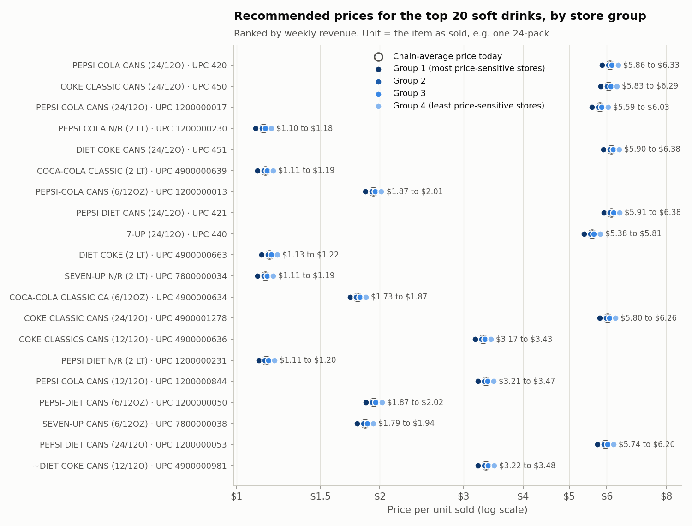

```{ojs}
//| output: false
P = import("https://cdn.jsdelivr.net/npm/@observablehq/plot@0.6.16/+esm")
truthy = v => v === true || String(v) === "True"
stores = FileAttachment("files/dominicks/stores.csv").csv({typed: true})
drivers = FileAttachment("files/dominicks/drivers.csv").csv({typed: true})
strategies = FileAttachment("files/dominicks/strategies.csv").csv({typed: true})
granularity = FileAttachment("files/dominicks/granularity_curve.csv").csv({typed: true})
products = FileAttachment("files/dominicks/products.csv").csv({typed: true})
productStores = FileAttachment("files/dominicks/product_store_top.csv").csv({typed: true})
pricingStores = stores.filter(d => d.elasticity_shrunk !== null)
K = 0.6404
tierDomain = ["High", "Medium", "Low", "CubFighter", "No tier"]
tierRange = ["#2a78d6", "#eb6834", "#1baf7a", "#eda100", "#9a9a96"]
groupRange = ["#0d366b", "#1c5cab", "#3987e5", "#86b6ef"]
chartStyle = ({fontFamily: "inherit", fontSize: "13px", background: "transparent", overflow: "visible"})
pct = (v, d = 1) => `${v > 0 ? "+" : ""}${v.toFixed(d)}%`
```

## The question

Walk into two branches of the same supermarket chain and you will usually find the same
price on the same can of soda. Dominick's Finer Foods, a chain of about 90 stores in the
Chicago area during the 1990s, priced this way most of the time. In half of all
product-weeks in its soft-drink data, every store charged exactly the same price.

Its stores did not serve the same shoppers, though. Some sat in college towns along the
North Shore, others in working-class suburbs to the west. If shoppers in some stores react
less to price than shoppers in others, one price everywhere leaves money on the table.

This article asks two questions:

1. **Should Dominick's charge different prices in different stores?**
2. **If so, along what dimension should prices differ?**

The analysis covers **one product category, soft drinks**: one segment of what a
supermarket sells. Every elasticity, price and profit figure below is a soft-drink figure.

::: {.callout-note appearance="simple"}
## Key results

- **Stores really differ in price sensitivity.** Store elasticities run from −2.30 to
  −3.38, and most of that spread is real, not estimation noise.
- **Education is the clearest driver.** Stores in more college-educated areas are less
  price-sensitive. Income has no effect of its own once education is held fixed.
- **Store-level prices raise soft-drink gross profit by 0.24%**, about \$1,100 a week
  across 86 stores, compared with the best single price.
- **Measured elasticity is the right dimension.** Four store groups built on elasticity
  capture 76% of that gain. Dominick's official price tiers capture 10%.
- **Every one of the 1,608 soft-drink products gets a price in every store.** Within a
  store, all products move by the same percentage, from −3.7% to +4.0% under four groups.
:::

## The data

The data come from the Dominick's Finer Foods database at the Kilts Center for Marketing,
University of Chicago Booth School of Business. It contains weekly scanner data for each
product (UPC) in each store, plus store demographics from the 1990 census.

| Source file | Variable | Meaning |
|---|---|---|
| Movement (`wsdr`) | `UPC`, `STORE`, `WEEK` | Product, store and week identifiers: one row per product per store per week |
| | `MOVE` | Units sold that week |
| | `PRICE`, `QTY` | Shelf price for a bundle of `QTY` units; unit price = `PRICE / QTY` |
| | `PROFIT` | Gross margin as a percent of price |
| | `SALE` | Promotion code (bonus buy, coupon, price reduction); blank does not reliably mean no promotion |
| | `OK` | 1 if the row is valid |
| Product (`upcsdr`) | `DESCRIP`, `SIZE` | Product name and package size |
| Store list | `PRICE_TIER`, `ZONE`, `CITY` | Dominick's own price tier (High, Medium, Low, CubFighter), price zone (1 to 16) and town |
| Demographics (`demo`) | `income` | Log median household income |
| | `educ` | Share of adults with a college degree |
| | `age60` | Share of residents aged 60 or older |
| | `hsizeavg` | Average household size |
| | `cubdist` | Distance to the nearest Cub Foods, a discount competitor (label inferred from the variable name) |
| | `nocar`, `poverty` | Share of households without a car; poverty rate |

**Cleaning.** A row is used if it is valid (`OK = 1`), has a valid price, sold at least
one unit, and is not flagged by a price-outlier rule. The rule flags implausible unit
prices but exempts deposits on returnable bottles. The store roster was reconciled across
files. The final estimation sample has **10.7 million rows** covering 93 stores.

Two facts from the cleaned data frame the rest of the analysis:

- **Pricing is already close to uniform.** In 51% of product-weeks every store charged the
  same price. Regular prices in the official tiers differ from the chain median by less
  than 1%, except CubFighter stores at about 3% below.
- **Margins are thin.** Gross margin on regular weeks averages 17.4% of revenue. Including
  promotion weeks it falls to 9.7%, and 13% of rows sold at zero or negative margin.

| Price tier | Regular price vs. chain median |
|---|---|
| High | +0.4% |
| Medium | −0.1% |
| Low | −0.9% |
| CubFighter | −2.8% |
| No tier | −0.5% |

## Step 1: An elasticity for every store

### What an elasticity is

A price elasticity measures how strongly unit sales react to price, in percentage terms:

$$
\text{elasticity} = \frac{\%\ \text{change in units sold}}{\%\ \text{change in price}}
$$

Take the best-selling item in the data, a 24-pack of Pepsi cans at about \$6.09. Suppose
a store's elasticity is −2.8 and it sells 100 packs a week. Raising the price by 1%, to
\$6.15, cuts sales by about 2.8%, to roughly 97 packs. Revenue falls too, by about
1% − 2.8% = −1.8%, because the volume loss is larger than the price gain. Any elasticity
below −1 is called *elastic*: price increases lose revenue. The closer the elasticity is to
zero, the less shoppers react to price.

### Why the model is written in logs

Percentages are awkward to put into a regression, but logarithms turn them into plain
differences: a small change in $\log x$ is approximately the percentage change in $x$.
So if demand follows

$$
q = A \cdot p^{\beta} \quad\Longleftrightarrow\quad \log q = \log A + \beta \log p,
$$

the slope $\beta$ of $\log q$ on $\log p$ is exactly the elasticity. This form also assumes
the elasticity is the same at every price, which is called *constant elasticity*. A
comparison of functional forms supports it here: a semi-log model, where only sales are
logged, fits clearly worse, and adding a squared log-price term barely improves the fit
(within-R² of 0.301 vs. 0.298).

### The model, store by store

For each store $s$, I regress weekly log units on log price for every soft-drink product
the store sells:

$$
\log q_{ut} = \alpha_u + \delta_t + \beta_s \log p_{ut} + \varepsilon_{ut}
\qquad \text{(estimated separately for each store } s\text{)}
$$

| Symbol | Meaning | Example |
|---|---|---|
| $u$, $t$ | Product (UPC) and week | Pepsi 24-pack cans; week 250 |
| $q_{ut}$ | Units of product $u$ sold in week $t$ (`MOVE`) | 120 packs |
| $p_{ut}$ | Unit price of product $u$ in week $t$ (`PRICE / QTY`) | \$5.99 per pack |
| $\alpha_u$ | **Product fixed effect**: a separate intercept for each product, its normal sales level in this store | Pepsi 24-packs always sell far more than a niche ginger ale |
| $\delta_t$ | **Week fixed effect**: a separate intercept for each week, capturing anything that moves all soft-drink sales in this store that week | A hot July 4th week lifts every product |
| $\beta_s$ | **Store $s$'s price elasticity**, the quantity of interest | −2.8 |
| $\varepsilon_{ut}$ | Everything the model does not explain | A local event, a stock-out |

**What the fixed effects buy.** Without them, the regression would compare *different*
products: cheap 2-liter bottles sell many units and expensive 24-packs fewer, which would
look like price sensitivity even if no shopper ever reacted to a price change. With a
product effect, each product is compared only with itself. With a week effect, a week when
everything sells more (a holiday, a heat wave) is not mistaken for a price response. What
remains is the question the elasticity should answer: *in weeks when this product was
cheaper than usual in this store, compared with how that week went for the store's other
soft drinks, did it sell more than usual, and by how much?* $\beta_s$ averages that
response across all products in the store.

**What "store elasticity" means.** $\beta_s$ is the typical own-price elasticity of a
soft-drink product in store $s$. It includes shoppers who switch to another soft drink in
the same store when one product gets more expensive, which is why it is larger in size
than an elasticity for soft drinks as a whole would be.

**How much data each store has.** A typical store contributes about 128,000
product-weeks (between 50,000 and 154,000), covering about 1,200 products over roughly
380 weeks.

**Standard errors** are clustered by product within each store. The same product observed
in many weeks is not treated as many independent pieces of evidence.

<details>
<summary>Show code: the store-by-store regression</summary>

```python
import pyfixest as pf

rows = []
for store, sub in panel.groupby("store"):
    m = pf.feols("log_move ~ log_price | upc + week", data=sub,
                 vcov={"CRV1": "upc"})
    rows.append({"store": store,
                 "elasticity": m.coef()["log_price"],
                 "se": m.se()["log_price"]})
```
</details>

### Every store, ranked

Each dot is a store's estimated elasticity, and the line is its 95% confidence interval.
Further left means more price-sensitive. Hover for the store's details. Seven stores with
fewer than two years of data are hidden by default.

```{ojs}
viewof showLowData = Inputs.toggle({label: "Include 7 low-data stores", value: false})
```

```{ojs}
{
  const data = stores.filter(d => showLowData || !truthy(d.low_data))
    .slice().sort((a, b) => a.elasticity - b.elasticity)
  const order = data.map(d => String(d.store))
  const avg = d3.mean(data, d => d.elasticity)
  return P.plot({
    width, height: Math.max(420, data.length * 6.2), marginLeft: 10, marginRight: 20,
    style: chartStyle, marginBottom: 50,
    x: {labelAnchor: "center", labelOffset: 40, label: "Price elasticity (95% CI) →  less price-sensitive", domain: [-3.8, -2.0], grid: true},
    y: {domain: order, axis: null},
    color: {domain: tierDomain, range: tierRange, legend: true},
    marks: [
      P.ruleX([avg], {stroke: "#888", strokeDasharray: "4 3"}),
      P.text([avg], {x: d => d, frameAnchor: "top", dy: -4, text: d => `average ${d.toFixed(2)}`, fill: "#666", textAnchor: "start", dx: 4}),
      P.ruleY(data, {y: d => String(d.store), x1: "ci_lo", x2: "ci_hi", stroke: "price_tier", strokeOpacity: 0.45, strokeWidth: 2}),
      P.dot(data, {y: d => String(d.store), x: "elasticity", fill: "price_tier", r: 3.5, stroke: "white", strokeWidth: 0.8,
        channels: {Store: "store", City: "city", Tier: "price_tier", "Weeks of data": "n_weeks", "Std. error": d => d.se.toFixed(3)},
        tip: {format: {y: false, fill: false, x: d => d.toFixed(2)}}})
    ]
  })
}
```

Excluding the low-data stores, elasticities range from **−3.38** (store 64, Villa Park) to
**−2.30** (store 33, Chicago). Every store is elastic: a price increase loses more in
volume than it gains in price.

### What an elasticity means in units

The chart turns elasticities into demand curves. Each grey line is one store, and the
highlighted lines are the most and least price-sensitive. Move the slider to see what a
given price change does to unit sales.

```{ojs}
viewof priceMove = Inputs.range([-10, 10], {step: 1, value: 5, label: "Price change (%)"})
```

```{ojs}
{
  const ext = pricingStores.slice().sort((a, b) => a.elasticity - b.elasticity)
  const most = ext[0], least = ext[ext.length - 1]
  const xs = d3.range(-10, 10.01, 0.5)
  const curve = s => xs.map(x => ({store: s.store, city: s.city, x, y: 100 * Math.pow(1 + x / 100, s.elasticity)}))
  const all = pricingStores.flatMap(curve)
  const at = s => 100 * Math.pow(1 + priceMove / 100, s.elasticity) - 100
  return html`<div>
  <p style="margin:0 0 .5rem 0">A <b>${pct(priceMove, 0)}</b> price change moves unit sales by
  <b style="color:#0d366b">${pct(at(most))}</b> in store ${most.store} (${most.city}) and by
  <b style="color:#2a78d6">${pct(at(least))}</b> in store ${least.store} (${least.city}).</p>
  ${P.plot({
    width, height: 360, style: chartStyle, marginBottom: 50, marginRight: 120,
    x: {labelAnchor: "center", labelOffset: 40, label: "Price change (%)", domain: [-10, 10]},
    y: {label: "Unit sales index (today = 100)", grid: true},
    marks: [
      P.line(all, {x: "x", y: "y", z: "store", stroke: "#bbb", strokeWidth: 0.8, strokeOpacity: 0.6}),
      P.line(curve(most), {x: "x", y: "y", stroke: "#0d366b", strokeWidth: 2}),
      P.line(curve(least), {x: "x", y: "y", stroke: "#2a78d6", strokeWidth: 2}),
      P.ruleX([priceMove], {stroke: "#eb6834", strokeWidth: 1.5}),
      P.dot([most, least], {x: () => priceMove, y: s => 100 + at(s), fill: (s, i) => i ? "#2a78d6" : "#0d366b", r: 5, stroke: "white"}),
      P.text([most], {x: () => 10, y: s => 100 * Math.pow(1.1, s.elasticity), text: s => `Store ${s.store}, e = ${s.elasticity.toFixed(2)}`, textAnchor: "start", dx: 6, fill: "#0d366b"}),
      P.text([least], {x: () => 10, y: s => 100 * Math.pow(1.1, s.elasticity), text: s => `Store ${s.store}, e = ${s.elasticity.toFixed(2)}`, textAnchor: "start", dx: 6, fill: "#2a78d6"}),
      P.tip(all, P.pointer({x: "x", y: "y", channels: {Store: "store", City: "city"}, format: {x: d => `${d}%`, y: d => d.toFixed(1)}}))
    ]
  })}</div>`
}
```

Because the model assumes a constant elasticity, the outer parts of the chart are
extrapolations. That is one reason the pricing step later limits price changes to ±10%.

## Are the differences real?

Every estimate comes with noise, so a spread across 86 stores could appear even if all
stores were identical. Two checks address this.

**A heterogeneity test** compares the spread of the estimates with their standard errors:

$$
Q = \sum_s w_s \left(\hat\beta_s - \bar\beta\right)^2, \qquad w_s = \frac{1}{\mathrm{se}_s^2}
$$

| Symbol | Meaning |
|---|---|
| $\hat\beta_s$, $\mathrm{se}_s$ | Store $s$'s estimated elasticity and its standard error |
| $\bar\beta$ | Precision-weighted average elasticity |
| $Q$ | Weighted spread; if all stores were truly identical, $Q$ would be close to the number of stores minus one |
| $\tau$ | Standard deviation of the *true* elasticities, after removing the part of the spread that noise explains |

For the 86 stores, $Q = 485$ against about 85 expected under no real differences
(p < 10⁻⁵⁰). The true spread is $\tau = 0.23$, against a typical standard error of 0.12.
About **80% of the observed variance is real**.

**Robustness checks** re-estimate every store under different choices and compare the
rankings:

| Alternative estimate | Rank correlation with main estimate | Average shift |
|---|---|---|
| One shared set of week effects for all stores | 0.97 | +0.02 |
| Promotion controls added | 0.95 | +0.42 |
| Only products and weeks common to all stores | 0.97 | −0.03 |

The promotion check moves every store, so it is worth a closer look. Sales jump in
promotion weeks partly because of the promotion itself (displays, ads), not only because
of the lower price. The simple model credits that jump to the price cut. Adding a
promotion dummy and a promotion × price term removes it, and every store becomes about 0.4
less elastic. The ranking of stores barely changes. In the chart, the dashed line is
where both estimates would be equal.

```{ojs}
P.plot({
  width, height: 380, style: chartStyle, marginBottom: 50,
  x: {labelAnchor: "center", labelOffset: 40, label: "Main elasticity", grid: true},
  y: {label: "With promotion controls", grid: true},
  color: {domain: tierDomain, range: tierRange, legend: true},
  marks: [
    P.line([[-3.6, -3.6], [-2.2, -2.2]], {stroke: "#999", strokeDasharray: "4 3"}),
    P.dot(stores.filter(d => !truthy(d.low_data)), {x: "elasticity", y: "elasticity_promo_ctrl", fill: "price_tier", r: 4, stroke: "white", strokeWidth: 0.8,
      channels: {Store: "store", City: "city"}, tip: {format: {fill: false, x: d => d.toFixed(2), y: d => d.toFixed(2)}}})
  ]
})
```

::: {.callout-note appearance="simple"}
## Why the main model does not include promotion controls

**What the promotion check changes.** Adding promotion controls shifts every store's
elasticity toward zero. Among the 86 stores used for pricing, the average moves from −2.79
to −2.37; every store moves, by between 0.27 and 0.55. The main model is therefore the more
elastic of the two. What the controls change is the *level* of the elasticities, not
their *order*. The spread across stores is the same in both versions (a standard deviation
of 0.20), and the ranking is nearly identical (rank correlation 0.94 among these 86
stores).

**Why it is a check and not the main model.** The promotion controls rely on the `SALE`
field, and that field is incomplete. The Dominick's documentation notes that a blank `SALE`
code does not reliably mean there was no promotion. Some promotion weeks are therefore
still counted as regular weeks, so the control removes only part of the promotion effect,
and how much it misses is unknown. Rather than build the analysis on a partly measured
variable, the main model leaves it out and the promotion version is reported as a check.

**What this means for the rest of the article.**

- **Which stores are more or less price-sensitive does not depend on this choice.** Store
  groups, which stores get higher or lower prices, and the comparison between pricing
  strategies all rest on the ranking, and the ranking holds.
- **The drivers do not change.** In the version of the Step 2 model with promotion terms,
  education is still the main driver (+0.12, p < 0.001), and income stays slightly negative
  once education is held fixed.
- **The overall price level does not change.** The pricing step calibrates cost so that
  today's average price is the best single price, whatever the average elasticity is.
- **The size of the price gaps could change.** Closer to −1, the same elasticity gap
  translates into a larger price gap, so with the promotion-controlled elasticities the
  store price differences, and the 0.24% gain, would likely be somewhat larger. The
  figures in this article are those of the main model.
:::

## Step 2: What makes a store more price-sensitive?

Knowing *that* stores differ is half the story. The second model asks *which* store
characteristics go with higher or lower sensitivity. It pools all stores and lets the
price coefficient depend on store characteristics:

$$
\log q_{ust} = a_{us} + d_t + b_0 \log p_{ust} + \sum_k \gamma_k \, Z_{ks} \log p_{ust} + \varepsilon_{ust}
$$

| Symbol | Meaning |
|---|---|
| $a_{us}$ | Fixed effect for each product in each store (about 105,000 of them) |
| $d_t$ | Week fixed effect |
| $Z_{ks}$ | Characteristic $k$ of store $s$, standardized across stores (mean 0, standard deviation 1) |
| $b_0$ | Elasticity of a store with average characteristics |
| $\gamma_k$ | Change in elasticity when characteristic $k$ rises by one standard deviation |

A store's elasticity is therefore $b_0 + \sum_k \gamma_k Z_{ks}$. **A positive $\gamma_k$
means less price-sensitive**, because it moves the elasticity toward zero. The
characteristics do not appear on their own because $a_{us}$ already absorbs anything fixed
about a store; they can only enter through their interaction with price. Standard errors
are clustered by store, since the characteristics vary only across the 83 stores with
demographic data.

### The store characteristics

Each store's trading area is described by 1990 census figures in the store file. The table
gives each characteristic's average and range across the 83 stores with demographic data,
and what one standard deviation (SD), the unit behind every $\gamma_k$, means in plain
terms.

| Characteristic | What it measures | Average (range) | 1 SD equals | Why it might matter for price sensitivity |
|---|---|---|---|---|
| **Income** | Log of median household income | \$40,900 (\$19,300 to \$75,800) | About 28% higher income | Richer households spend a smaller share of their budget on groceries |
| **Education** | Share of adults with a college degree | 23% (5% to 53%) | 11 percentage points | Linked to income over a lifetime and to the value of shoppers' time |
| **Age 60+** | Share of residents aged 60 or older | 17% (6% to 31%) | 6 percentage points | Retirees have more time to compare prices, but often lower incomes |
| **Household size** | Average persons per household | 2.66 (1.55 to 3.31) | 0.26 persons | Larger households buy more soda, so prices weigh more in their budget |
| **Distance to Cub Foods** | Miles to the nearest Cub Foods, a low-price competitor | 6.2 miles (0.1 to 17.9) | 3.8 miles | A nearby discount store gives shoppers an easy alternative |
| **No-car share** | Share of households without a car | 11% (1% to 55%) | 13 percentage points | Shoppers without a car cannot easily shop around |
| **Poverty** | Share of residents below the poverty line | 6% (1% to 21%) | 4 percentage points | Tight budgets make prices matter more |

The "why it might matter" column lists the usual reasons for expecting an effect. The
model then checks which of them show up in the data. The label for distance to Cub Foods
is inferred from the variable name in the store file.

**The characteristics move together**, which shapes how the results read:

| | Income | Education | Age 60+ | Household size | Cub distance | No car | Poverty |
|---|---|---|---|---|---|---|---|
| **Income** | 1 | 0.66 | −0.15 | 0.32 | −0.31 | −0.83 | −0.90 |
| **Education** | | 1 | −0.31 | −0.15 | −0.09 | −0.28 | −0.47 |
| **Age 60+** | | | 1 | −0.37 | 0.30 | 0.18 | 0.16 |
| **Household size** | | | | 1 | −0.17 | −0.55 | −0.34 |
| **Cub distance** | | | | | 1 | 0.39 | 0.41 |
| **No car** | | | | | | 1 | 0.92 |

Income, no-car share and poverty are close to one variable seen from three sides
(correlations of 0.83 to 0.92 in size). Putting them in one regression would leave the
model unable to tell them apart. The core model therefore uses five characteristics
(income, education, age 60+, household size and distance to Cub Foods), and no-car share
and poverty are tested as replacements for income.

<details>
<summary>Show code: the interaction model</summary>

```python
z = (chars - chars.mean()) / chars.std()          # standardize across stores
for var in ["income", "age60", "educ", "hsizeavg", "cubdist"]:
    panel[f"lp_x_{var}"] = panel["log_price"] * panel["store"].map(z[var])

m = pf.feols("log_move ~ log_price + lp_x_income + lp_x_age60 + lp_x_educ"
             " + lp_x_hsizeavg + lp_x_cubdist | upc_store + week",
             data=panel, vcov={"CRV1": "store"})
```
</details>

### Alone vs. together

Each characteristic is tested twice:

- **Alone**: the model contains only that one characteristic. Its coefficient picks up
  everything that travels with it. If educated areas also have higher incomes, the
  "alone" coefficient on education partly reflects income too.
- **Together**: all five core characteristics are in the model at once. Each coefficient
  now measures the difference between two stores that are alike in the other four
  characteristics. This is the part of the effect that belongs to that characteristic.

A characteristic that matters alone but not together was probably standing in for
something else. Filled dots are significant at the 5% level, and lines are 95% confidence
intervals. For no-car share and poverty, the "together" value comes from the model where
each replaces income.

```{ojs}
viewof driverMode = Inputs.radio(["Alone", "Together"], {value: "Together", label: "Model"})
```

```{ojs}
{
  const key = driverMode === "Alone" ? "alone" : "together"
  const data = drivers.map(d => ({
    label: d.label, est: d[key], p: d[`${key}_p`], se: d[`${key}_se`],
    lo: d[`${key}_se`] == null ? null : d[key] - 1.96 * d[`${key}_se`],
    hi: d[`${key}_se`] == null ? null : d[key] + 1.96 * d[`${key}_se`]
  }))
  const order = drivers.slice().sort((a, b) => b.together - a.together).map(d => d.label)
  return P.plot({
    width, height: 300, marginLeft: 220, style: chartStyle, marginBottom: 50,
    x: {labelAnchor: "center", labelOffset: 40, label: "Change in elasticity per 1 SD  →  less price-sensitive", domain: [-0.13, 0.2], grid: true},
    y: {domain: order, label: null},
    marks: [
      P.ruleX([0], {stroke: "#666"}),
      P.ruleY(data.filter(d => d.lo != null), {y: "label", x1: "lo", x2: "hi", stroke: "#2a78d6", strokeWidth: 2, strokeOpacity: 0.6}),
      P.dot(data, {y: "label", x: "est", r: 6, stroke: "#2a78d6", strokeWidth: 2, fill: d => d.p < 0.05 ? "#2a78d6" : "white",
        channels: {"p-value": d => d.p < 0.001 ? "< 0.001" : d.p.toFixed(3)}, tip: {format: {fill: false, x: d => d.toFixed(3)}}})
    ]
  })
}
```

| Characteristic | Alone | Together | What the model says |
|---|---|---|---|
| **Education** | +0.072 (p < 0.001) | +0.119 (p < 0.001) | **Main driver.** More college-educated areas are less price-sensitive, in every version of the model. |
| **Income** | +0.011 (p = 0.60) | −0.061 (p = 0.03) | **No effect of its own.** Income moves with education (r = 0.66); once education is fixed, higher income does not reduce sensitivity. |
| **No-car share / poverty** | +0.041 / +0.015 | +0.072 / +0.061 | **The same signal as income, mirrored**, and inseparable from it. |
| **Household size** | −0.071 (p < 0.001) | −0.026 (p = 0.26) | **Possible, not confirmed.** It also moves with car ownership, age and income; with those fixed, too little of its own effect remains. |
| **Age 60+** | +0.007 (p = 0.71) | +0.033 (p = 0.12) | No detectable effect. |
| **Distance to Cub Foods** | +0.009 (p = 0.67) | −0.016 (p = 0.40) | No detectable effect. |

### Reading each characteristic

**Education: the main driver.** One SD more college graduates (11 percentage points) moves
the elasticity by +0.12 with the other characteristics held fixed. The average store sits
at about −2.77, so a store one SD above average in education is at about −2.65: a 1% price
increase costs it about 2.65% of volume instead of 2.77%. Across the full range, from the
least educated area (5% graduates) to the most educated (53%), that is a difference of
about 0.5 in elasticity, more than twice the true spread across stores. The effect is
significant alone and together, and in every variant of the model, including the ones that
swap income for no-car share or poverty.

Why would educated areas be *less* price-sensitive? Comparing prices takes time, and the
time of college-educated shoppers is worth more on the job market, so shopping around
costs them more. Education may also capture long-run income and wealth better than one
year's median income. The store file's shopper-type indices (hurried, avid and constrained
shoppers) could test the time-cost explanation directly.

**Income: no effect of its own.** Alone, income's coefficient is +0.011 with p = 0.60:
richer areas are not measurably less price-sensitive. Together, it turns negative (−0.061,
p = 0.03). The sign flip comes from the 0.66 correlation with education. Alone, income
borrows some of education's effect. Once education is held fixed, the remaining
comparison is between two equally educated areas with different incomes, and there the
richer one is slightly *more* price-sensitive. The practical reading: income by itself is
not what makes a store less sensitive. Education is.

**No-car share and poverty: income seen from the other side.** Both are strongly
negatively correlated with income (−0.83 and −0.90). When either replaces income in the
joint model, it takes a positive coefficient (+0.072 and +0.061), the mirror image of
income's −0.061. The data cannot separate these three; they carry one shared signal about
an area's economic position.

**Household size: possible, not confirmed.** Alone, larger households go with higher price
sensitivity (−0.071, p < 0.001), which fits the idea that families buying more soda feel
price more. Together, the coefficient shrinks to −0.026 and is no longer significant
(p = 0.26). Household size moves with car ownership (−0.55), age (−0.37) and income
(0.32), and once those are held fixed too little of its own effect remains to be sure it
is real.

**Age 60+: no detectable effect.** Neither alone (+0.007, p = 0.71) nor together (+0.033,
p = 0.12). Retirees may have more time to compare prices but also differ in many other
ways, and on balance no effect shows up.

**Distance to Cub Foods: no detectable effect.** If a nearby discount competitor made
shoppers more price-sensitive, stores farther from Cub Foods would be less sensitive, a
positive coefficient. The estimates are close to zero alone (+0.009, p = 0.67) and
together (−0.016, p = 0.40). One possible reason is that Dominick's already prices its
CubFighter stores, those facing Cub Foods directly, about 3% lower, which may absorb part
of the competitive pressure.

### See it store by store

Pick a characteristic to plot against each store's own elasticity from Step 1. The line
is a simple linear fit.

```{ojs}
viewof charPick = Inputs.select(new Map(drivers.map(d => [d.label, d.factor])), {value: "educ", label: "Characteristic"})
```

```{ojs}
{
  const data = stores.filter(d => d[charPick] != null && !truthy(d.low_data))
  const mx = d3.mean(data, d => d[charPick]), my = d3.mean(data, d => d.elasticity)
  const r = d3.sum(data, d => (d[charPick] - mx) * (d.elasticity - my)) /
    Math.sqrt(d3.sum(data, d => (d[charPick] - mx) ** 2) * d3.sum(data, d => (d.elasticity - my) ** 2))
  const label = drivers.find(d => d.factor === charPick).label
  return html`<div><p style="margin:0 0 .5rem 0">Correlation with store elasticity across ${data.length} stores: <b>r = ${r.toFixed(2)}</b></p>
  ${P.plot({
    width, height: 360, style: chartStyle, marginBottom: 50,
    x: {label, grid: true}, y: {label: "Store elasticity", grid: true},
    marks: [
      P.linearRegressionY(data, {x: charPick, y: "elasticity", stroke: "#eb6834", fill: "#eb6834", fillOpacity: 0.1}),
      P.dot(data, {x: charPick, y: "elasticity", fill: "#2a78d6", r: 4, stroke: "white", strokeWidth: 0.8,
        channels: {Store: "store", City: "city"}, tip: {format: {x: d => d.toFixed(3), y: d => d.toFixed(2)}}})
    ]
  })}</div>`
}
```

**How much do characteristics explain?** Regressing each store's elasticity on the five
characteristics, weighted by precision, gives an R² of **37%** across 83 stores. The
biggest misses are the most elastic stores. Six stores with short histories (fewer than
300 weeks) account for much of this: without them, R² rises to **54%**. So demographics
explain a good part of the differences, but far from all of them. That matters for
pricing.

## Step 3: From elasticity to price

The pricing step follows a simple counterfactual. Start from **one price per product,
the same in every store**. Then let each store, or each group of stores, move its prices
and see how much gross profit changes.

**Price index.** Each product's base price $\bar p_u$ is its chain-average price
(revenue / units across all stores and weeks). A store's prices are written as a multiple
$r$ of the base price, so $r = 1$ is the chain-average price and $r = 1.05$ is 5% above it.
All products in a store move by the same percentage. This keeps relative prices inside
the store unchanged, so the model does not need to know how shoppers switch between
products.

**Profit of a store** at price index $r$, with a constant elasticity:

$$
\pi_s(r) = (r - k)\, R_s\, r^{\,e_s}
$$

| Symbol | Meaning |
|---|---|
| $r$ | Price index (1 = chain-average price) |
| $k$ | Unit cost as a share of the chain-average price |
| $R_s$ | Store $s$'s weekly soft-drink revenue at the chain-average price |
| $e_s$ | Store $s$'s elasticity (shrunk; see below) |
| $(r - k)$ | Margin per dollar of base price |
| $R_s r^{e_s}$ | Sales (in base-price dollars) after the price moves to $r$ |

**The best price.** Setting the derivative to zero,
$\frac{d\pi_s}{dr} = R_s r^{e_s - 1}\left[r + e_s(r - k)\right] = 0$, gives the textbook
markup rule:

$$
r^*_s = \frac{k\,|e_s|}{|e_s| - 1}
\qquad\Longleftrightarrow\qquad
\frac{r^*_s - k}{r^*_s} = \frac{1}{|e_s|}
$$

The right-hand form is the Lerner condition: the best margin equals one over the
elasticity. Less price-sensitive stores (smaller $|e_s|$) get higher prices. When a group
of stores must share one price, the shared price maximizes the group's total profit
$\sum_{s \in g} \pi_s(r)$. It is found numerically and sits between the members' own best
prices, weighted by revenue.

Try it below: drag the elasticity and watch where profit peaks. The two grey curves are
the most and least price-sensitive stores. Notice how flat the curves are near the top.

```{ojs}
viewof eTry = Inputs.range([-3.6, -2.2], {step: 0.01, value: -2.78, label: "Store elasticity"})
```

```{ojs}
{
  const xs = d3.range(0.85, 1.1501, 0.0025)
  const rel = (r, e) => 100 * ((r - K) * Math.pow(r, e) / (1 - K) - 1)
  const best = e => Math.min(1.1, Math.max(0.9, K * Math.abs(e) / (Math.abs(e) - 1)))
  const ext = pricingStores.slice().sort((a, b) => a.elasticity_shrunk - b.elasticity_shrunk)
  const refs = [ext[0], ext[ext.length - 1]]
  const refLines = refs.flatMap(s => xs.map(r => ({store: s.store, x: 100 * (r - 1), y: rel(r, s.elasticity_shrunk)})))
  const line = xs.map(r => ({x: 100 * (r - 1), y: rel(r, eTry)}))
  const rb = best(eTry)
  return html`<div><p style="margin:0 0 .5rem 0">With elasticity <b>${eTry.toFixed(2)}</b> and cost at 64% of the base price,
  the best price is <b>${pct(100 * (rb - 1))}</b>, and it earns <b>${pct(rel(rb, eTry), 2)}</b> more profit than the chain-average price.</p>
  ${P.plot({
    width, height: 360, style: chartStyle, marginBottom: 50,
    x: {labelAnchor: "center", labelOffset: 40, label: "Price change from chain average (%)"},
    y: {label: "Profit change vs. chain-average price (%)", grid: true, domain: [-12, 4]},
    clip: true,
    marks: [
      P.ruleY([0], {stroke: "#999"}),
      P.line(refLines, {x: "x", y: "y", z: "store", stroke: "#bbb", strokeWidth: 1.2}),
      P.text(refs, {x: s => 100 * (best(s.elasticity_shrunk) - 1), y: s => rel(best(s.elasticity_shrunk), s.elasticity_shrunk), text: s => `Store ${s.store}`, dy: -10, fill: "#888"}),
      P.line(line, {x: "x", y: "y", stroke: "#2a78d6", strokeWidth: 2.5}),
      P.dot([rb], {x: r => 100 * (r - 1), y: r => rel(r, eTry), fill: "#eb6834", r: 6, stroke: "white"}),
      P.tip(line, P.pointer({x: "x", y: "y", format: {x: d => `${d.toFixed(1)}%`, y: d => `${d.toFixed(2)}%`}}))
    ]
  })}</div>`
}
```

### Two safeguards

Before the markup rule turns elasticities into prices, two adjustments protect the result
from the model's own weaknesses: noise in the estimates, and a demand curve that is only
reliable close to observed prices.

#### Safeguard 1: Shrink noisy elasticities toward the mean

**The problem: the optimizer's curse.** Every store elasticity is an estimate with some
error. When prices are set from estimates, the stores that look the most extreme are, on
average, the ones whose errors happened to push them outward. The pricing rule then gives
those stores the largest price changes, and it predicts gains that will not show up in
reality, because part of the extremeness was noise. Decision scientists call this the
*optimizer's curse* (or the winner's curse). It appears whenever the option that looks
best is picked from noisy estimates, and it is a known issue in data-driven pricing,
targeting and A/B testing.

**The fix: empirical-Bayes shrinkage.** The standard remedy is to pull each estimate toward
the group average by an amount that depends on how noisy it is. A classic demonstration
comes from baseball: early-season batting averages, shrunk toward the league average,
predicted players' rest-of-season averages better than the raw early-season numbers. The
same logic applies to stores. A store whose estimate is precise keeps most of its own
value; a store with a noisy estimate is pulled further toward the chain mean:

$$
e^{\text{shrunk}}_s = \mu + w_s\left(\hat\beta_s - \mu\right),
\qquad w_s = \frac{\tau^2}{\tau^2 + \mathrm{se}_s^2}
$$

| Symbol | Meaning |
|---|---|
| $\hat\beta_s$ | Store $s$'s raw elasticity from Step 1 |
| $\mu$ | Chain mean elasticity, weighted by precision (about −2.79) |
| $\tau$ | Spread of the *true* store elasticities, from the heterogeneity test (0.23) |
| $\mathrm{se}_s$ | Store $s$'s standard error: how noisy its estimate is |
| $w_s$ | Weight on the store's own estimate, between 0 and 1 |

The weight has a direct reading. $\tau^2$ is the real variation across stores and
$\mathrm{se}_s^2$ is the noise in store $s$'s estimate, so $w_s$ is the share of the
store's observed distance from the mean that is believed to be real. Here the weights run
from 0.59 for the noisiest store to 0.94 for the most precise, with a median of 0.80. The
largest adjustment is store 59 (Crystal Lake), whose raw estimate of −3.12 has a standard
error of 0.16 and moves to −3.01. The median store moves by only 0.02.

The chart shows each store's raw estimate (grey) and shrunk estimate (blue), sorted by the
raw value. Hover to see the numbers.

```{ojs}
{
  const data = pricingStores.slice().sort((a, b) => a.elasticity - b.elasticity)
    .map(d => ({...d, w: 0.2294 ** 2 / (0.2294 ** 2 + d.se ** 2), id: String(d.store)}))
  return P.plot({
    width, height: Math.max(420, data.length * 6.2), marginLeft: 10, marginTop: 28, style: chartStyle, marginBottom: 50,
    x: {labelAnchor: "center", labelOffset: 40, label: "Elasticity  →  less price-sensitive", domain: [-3.45, -2.2], grid: true},
    y: {domain: data.map(d => d.id), axis: null},
    marks: [
      P.ruleX([-2.789], {stroke: "#eb6834", strokeDasharray: "4 3"}),
      P.text([-2.789], {x: d => d, frameAnchor: "top", dy: -4, dx: 4, textAnchor: "start", text: () => "chain mean μ", fill: "#eb6834"}),
      P.arrow(data, {y1: "id", y2: "id", x1: "elasticity", x2: "elasticity_shrunk", stroke: "#86b6ef", headLength: 4, strokeWidth: 1.2}),
      P.dot(data, {y: "id", x: "elasticity", fill: "#bbb", r: 3}),
      P.dot(data, {y: "id", x: "elasticity_shrunk", fill: "#2a78d6", r: 3.5, stroke: "white", strokeWidth: 0.6,
        channels: {Store: "store", City: "city", Raw: d => d.elasticity.toFixed(2), "Std. error": d => d.se.toFixed(3), "Weight on own estimate": d => d.w.toFixed(2)},
        tip: {format: {y: false, x: d => d.toFixed(2)}}})
    ]
  })
}
```

Shrinkage narrows the spread of store elasticities from an SD of 0.20 to 0.17, so the
recommended prices are a little less extreme. It also matters for the reported gain: with
raw elasticities, store-level pricing would appear to earn 0.35% instead of 0.24%. Much
of that difference is noise that would not turn into real profit, which is exactly what
the optimizer's curse predicts.

#### Safeguard 2: Cap price changes at ±10%

**The problem: the demand curve is only trustworthy near observed prices.** A
constant-elasticity curve is a convenient approximation that fits well in the range of
prices the stores actually charged. Taken far outside that range, it keeps applying the
same percentage response at any price, which real demand rarely does. Research in
marketing has shown that this matters for pricing: log-log demand models fit the data
well, but an optimizer working with them tends to recommend prices outside the observed
range, where the model has no evidence and its predictions are least reliable. Practical
pricing systems handle this with guardrails, bounds on how far a recommended price may
move from current prices.

**The fix: keep prices where the data are.** Store prices may move at most ±10% from the
best single price. That bound is well inside what the data cover: half of all observed
weekly prices lie within ±10% of that product's average price in the same store, and the
middle 90% span about −29% to +28%, mostly because of promotions. So every recommended
price sits in a range the model has seen many times.

The cap binds for only two stores, 33 (Chicago) and 137 (Evanston). The markup rule would
put them about 11% to 12% above the chain price, and the cap holds them at +10%. Removing
the cap changes the total store-level gain by less than 0.003 percentage points. The cap
is a guardrail, not a driver of the results.

### Choosing the cost

Cost matters for the price *level*. With an elasticity around −2.8, the markup rule says
the best margin is $1/2.8 \approx 36\%$. Dominick's actual regular-week margin is 17%. So
if the data's own cost is used, the model says *every* soft-drink price is too low. That
level effect would swamp the question this article is about, which is whether prices
should *differ* across stores.

The main case therefore calibrates the cost so that today's chain-average price is
already the best single price. Setting $\frac{d}{dr}\sum_s \pi_s(r) = 0$ at $r = 1$ and
solving for $k$:

$$
k = 1 + \frac{\sum_s R_s}{\sum_s R_s e_s} = 1 - \frac{1}{|\bar e_R|} = 0.640
$$

where $\bar e_R$ is the revenue-weighted average elasticity. The table compares this with
two alternatives:

| Cost assumption | Cost share $k$ | Best single price vs. today | Profit gain from that price | Extra gain from store-level prices |
|---|---|---|---|---|
| **Calibrated (main case)** | 0.64 | 0% | 0% | **+0.24%** |
| Data's own margin (`PROFIT`) | 0.83 | +29% | +31% | +0.24% |
| 80% of price | 0.80 | +25% | +21% | +0.24% |

The extra gain from store-level prices is about 0.24% whichever cost is used. The rest of
the article uses the calibrated cost.

::: {.callout-note appearance="simple"}
## Why Dominick's may price soft drinks below the "optimal" margin

The model says the profit-maximizing margin on soft drinks is about 36%, yet Dominick's
earns about 17% on regular weeks. This does not have to be a pricing mistake. The model
looks at one category in isolation, and soft drinks may play a different role in the
store.

- **Soft drinks bring shoppers in.** Coke and Pepsi are among the most recognized,
  most frequently bought and most easily compared items in a supermarket. A low price on
  them is visible, and it can be the reason a shopper chooses one store over another for
  the weekly trip. Retailers have long treated the category this way: in the grocery trade
  press, managers describe soft drinks as a "loss leader" that shoppers will make an extra
  trip for.
- **The profit is in the basket, not the bottle.** A shopper who comes in for a cheap
  24-pack usually leaves with other groceries as well. If those other items carry normal
  margins, the store can earn more on the whole basket than it gives up on soft drinks.
  Seen this way, a lower soft-drink margin is the price of attracting more trips, and a
  margin well below 36% can be the better choice for the store as a whole.
- **What the model cannot see.** The demand model here measures how soft-drink sales
  respond to soft-drink prices, and the profit function counts only soft-drink margin.
  Extra trips, other items in the basket, and shoppers choosing Dominick's over a
  competitor are all outside it. Research on loss leaders finds that such traffic and
  basket effects can exist but are hard to measure and vary a lot across categories and
  stores, so this explanation is plausible rather than proven for this data.

**The portfolio effect.** The markup rule treats soft drinks as a stand-alone product and
counts only soft-drink profit. A store that also counts the profit from everything else in
the basket should price soft drinks lower than that rule suggests: every extra shopper
drawn in by a cheaper 24-pack also buys other groceries, so that basket profit works like
a discount on the cost of soft drinks. The price that is best for the whole store, the
portfolio, can therefore sit well below the price that is best for soft drinks alone,
and still earn more in total.

The numbers in this article fit this reading. The calibrated cost that makes today's
prices optimal is 64% of price, while the data put the true cost at about 83%. If the gap
is a portfolio effect, today's prices are what a store would choose if each dollar of
soft drinks sold brought in about 19 cents of profit on other items. That figure is
implied by the model, not measured: the data contain no basket information to check it.

This is the reason the main case calibrates cost instead of using the margin from the
data. Taking the observed 17% margin at face value would make the model recommend raising
every soft-drink price by 29%, ignoring whatever role low soft-drink prices play in
bringing shoppers into the store. The calibrated cost accepts today's price level as
given and asks only the narrower question this article is about: whether prices should
differ *across stores*.
:::

<details>
<summary>Show code: profit, cost calibration and group prices</summary>

```python
from scipy.optimize import minimize_scalar

def profit(r, k, R, e):
    """Gross profit at price index r with unit cost k (share of base price)."""
    return (r - k) * R * r ** e

def calibrated_cost(R, e):
    """Cost share that makes the chain-average price the best single price."""
    return 1 + R.sum() / (R * e).sum()

def best_price(k, R, e, lo, hi):
    """Best shared price for a group of stores."""
    res = minimize_scalar(lambda r: -profit(r, k, R, e).sum(),
                          bounds=(lo, hi), method="bounded")
    return res.x

# Empirical-Bayes shrinkage
weight_own = tau**2 / (tau**2 + se**2)
e_shrunk = mu + weight_own * (e_raw - mu)
```
</details>

## Step 4: Results

### The best price for each store

Each dot is a store. The dashed line is the markup rule: the best price for a store with
that elasticity. Switch strategies to see how the official tiers and the four elasticity
groups compress the same pattern.

```{ojs}
viewof storeStrategy = Inputs.radio(["Store-level", "Elasticity quartiles", "Official price tiers"], {value: "Store-level", label: "Prices set by"})
```

```{ojs}
{
  const col = `price_change_pct: ${storeStrategy}`
  const es = d3.range(-3.4, -2.25, 0.01)
  const rule = es.map(e => ({e, y: 100 * (Math.min(1.1, Math.max(0.9, K * Math.abs(e) / (Math.abs(e) - 1))) - 1)}))
  return P.plot({
    width, height: 400, style: chartStyle, marginBottom: 50,
    x: {labelAnchor: "center", labelOffset: 40, label: "Store elasticity (shrunk)  →  less price-sensitive", grid: true},
    y: {label: "Price change from chain average (%)", grid: true, domain: [-11, 11]},
    color: {domain: tierDomain, range: tierRange, legend: true},
    marks: [
      P.ruleY([0], {stroke: "#999"}),
      P.line(rule, {x: "e", y: "y", stroke: "#666", strokeDasharray: "5 4"}),
      P.dot(pricingStores, {x: "elasticity_shrunk", y: col, fill: "price_tier", r: 4.5, stroke: "white", strokeWidth: 0.8,
        channels: {Store: "store", City: "city", Tier: "price_tier"},
        tip: {format: {fill: false, x: d => d.toFixed(2), y: d => `${d.toFixed(1)}%`}}})
    ]
  })
}
```

Under store-level pricing, prices range from **−8.5%** (store 64 in Villa Park; store 97 in
Aurora is close at −8.2%) to the **+10%** cap (store 33 in Chicago and store 137 in Evanston). Under
official tiers, every store in a tier gets the same price, and the tier prices barely
move. The High tier goes up about 1.6%, and the other tiers go slightly below average.

### Comparing pricing strategies

Each strategy splits the 86 stores into groups and gives every group its own best price.
Gains are measured against the best single price, which earns \$464,059 a week in gross
profit.

| Strategy | Groups | How stores are grouped |
|---|---|---|
| Official price tiers | 5 | Dominick's tiers, plus stores without a tier |
| Price zones | 16 | Dominick's own price zones |
| Education quartiles | 5 | Share of college-educated residents (plus stores without demographics) |
| Demographic-model quartiles | 5 | Elasticity predicted by the five characteristics in Step 2 |
| Elasticity quartiles | 4 | Each store's own estimated elasticity |
| Store-level | 86 | Every store has its own price |

The bars show the weekly gain, labeled with each strategy's share of the store-level gain.
Hover for details.

```{ojs}
{
  const base = 464059.19
  const data = strategies.filter(d => d.strategy !== "Single price").map(d => ({
    ...d, lo: d.gain_pct_p5 / 100 * base, hi: d.gain_pct_p95 / 100 * base,
    kind: ["Elasticity quartiles", "Store-level"].includes(d.strategy) ? "Based on measured elasticity" : "Based on tiers, zones or demographics"
  }))
  return P.plot({
    width, height: 300, marginLeft: 190, marginRight: 60, style: chartStyle, marginBottom: 50,
    x: {labelAnchor: "center", labelOffset: 40, label: "Weekly gross-profit gain over the best single price ($)", grid: true},
    y: {domain: data.slice().sort((a, b) => a.gain_weekly - b.gain_weekly).map(d => d.strategy), label: null},
    color: {domain: ["Based on measured elasticity", "Based on tiers, zones or demographics"], range: ["#2a78d6", "#a9b4c0"], legend: true},
    marks: [
      P.barX(data, {y: "strategy", x: "gain_weekly", fill: "kind", rx: 3, insetTop: 4, insetBottom: 4,
        channels: {"Gain (%)": d => `${d.gain_pct.toFixed(3)}%`, "Share of store-level gain": d => `${d.share_of_store_level_gain.toFixed(0)}%`},
        tip: {format: {fill: false, x: d => `$${d.toFixed(0)}`}}}),
      P.text(data, {y: "strategy", x: "gain_weekly", text: d => `${d.share_of_store_level_gain.toFixed(0)}%`, dx: 8, textAnchor: "start", fill: "#333"}),
      P.ruleX([0])
    ]
  })
}
```

| Strategy | Weekly gain | Gain (%) | Share of store-level gain |
|---|---|---|---|
| Official price tiers | \$108 | +0.02% | 10% |
| Education quartiles | \$150 | +0.03% | 13% |
| Demographic-model quartiles | \$283 | +0.06% | 25% |
| Price zones | \$337 | +0.07% | 30% |
| **Elasticity quartiles** | **\$854** | **+0.18%** | **76%** |
| **Store-level** | **\$1,124** | **+0.24%** | **100%** |

Three things stand out:

- **The gains are small everywhere.** Even full store-level pricing adds 0.24%. A spread
  of store elasticities with a standard deviation of about 0.23 around −2.8 only
  justifies price differences of about ±10%. Profit curves are flat near their peak, so
  small price differences bring small gains.
- **Measured elasticity beats every other way of grouping stores.** Four elasticity groups
  capture three quarters of the store-level gain.
- **Demographics explain elasticity but are not precise enough to price on.** Education is
  the clearest driver, yet education groups capture only 13% of the gain, because
  characteristics explain only part of the store differences (R² of 37%).

### How many price groups are enough?

The line shows the gain as stores are split into more and more groups by their own
elasticity, from one price for everyone to one price per store. The orange dots are the
other strategies, placed at their number of groups.

```{ojs}
{
  const others = strategies.filter(d => !["Single price", "Elasticity quartiles", "Store-level"].includes(d.strategy))
  return P.plot({
    width, height: 360, style: chartStyle, marginBottom: 50,
    x: {type: "log", labelAnchor: "center", labelOffset: 40, label: "Number of price groups (log scale)", ticks: [1, 2, 4, 8, 16, 43, 86], tickFormat: d => String(d)},
    y: {label: "Gain over the best single price (%)", grid: true, domain: [0, 0.26]},
    marks: [
      P.ruleY([0.2421], {stroke: "#2a78d6", strokeDasharray: "3 3", strokeOpacity: 0.6}),
      P.line(granularity, {x: "n_groups", y: "gain_pct", stroke: "#2a78d6", strokeWidth: 2}),
      P.dot(granularity, {x: "n_groups", y: "gain_pct", fill: "#2a78d6", r: 4, stroke: "white",
        channels: {"Share of store-level gain": d => `${(100 * d.gain_pct / 0.2421).toFixed(0)}%`},
        tip: {format: {x: d => `${d} groups`, y: d => `${d.toFixed(3)}%`}}}),
      P.dot(others, {x: "n_groups", y: "gain_pct", fill: "#eb6834", r: 6, stroke: "white",
        channels: {Strategy: "strategy"}, tip: {format: {x: d => `${d} groups`, y: d => `${d.toFixed(3)}%`}}}),
      P.text(others, {x: "n_groups", y: "gain_pct", text: "strategy", dx: 9, textAnchor: "start", fill: "#555", fontSize: 11})
    ]
  })
}
```

Two elasticity groups already capture about half of the store-level gain, and the curve is
nearly flat beyond 16 groups. Every alternative grouping sits below the curve.

## A price for every product

The store results translate into a price for each of the **1,608 soft-drink products** in
the 86 stores. The steps:

| Step | Formula | In words |
|---|---|---|
| 1. Base price | $\bar p_u = \dfrac{\sum_{s,t} p_{ust}\,q_{ust}}{\sum_{s,t} q_{ust}}$ | Chain-average price of product $u$ |
| 2. Unit cost | $c_u = k\,\bar p_u$, with $k = 0.640$ | Fixed dollar cost per unit |
| 3. Baseline units | $q^0_{us} = \dfrac{Q_{us}}{W_s}\left(\dfrac{\bar p_u}{P_{us}}\right)^{e_s}$ | Store's weekly units, moved from its own average price to the base price |
| 4. Demand | $q_{us}(p) = q^0_{us}\left(\dfrac{p}{\bar p_u}\right)^{e_s}$ | Units at a new price $p$ |
| 5. Group multiplier | $r_g = \arg\max_{0.9 \le r \le 1.1} \sum_{s \in g}\sum_u (r\,\bar p_u - c_u)\, q^0_{us}\, r^{e_s}$ | One price index per store group |
| 6. Recommended price | $p^*_{us} = r_{g(s)}\,\bar p_u$ | Product price in store $s$ |
| 7. Profit change | $\Delta\pi_u = \sum_s \big[(p^*_{us} - c_u)\,q_{us}(p^*_{us}) - (\bar p_u - c_u)\,q^0_{us}\big]$ | Weekly gain from product $u$ |

| Symbol | Meaning |
|---|---|
| $u$, $s$, $t$, $g$ | Product, store, week, store group |
| $Q_{us}$, $W_s$, $P_{us}$ | Total units of $u$ sold in $s$, the store's number of weeks, and the average price paid |
| $g(s)$ | The group that store $s$ belongs to |

Summing $\Delta\pi_u$ over all products gives exactly the strategy totals above. Under the
four elasticity groups, the multipliers are:

| Group | Stores | Elasticity range | Price change |
|---|---|---|---|
| 1 (most price-sensitive) | 22 | −3.33 to −2.86 | −3.7% |
| 2 | 21 | −2.86 to −2.76 | −0.6% |
| 3 | 22 | −2.75 to −2.70 | +1.0% |
| 4 (least price-sensitive) | 21 | −2.70 to −2.35 | +4.0% |

### The top 20 products at a glance

{fig-alt="Dot plot of recommended prices for the top 20 soft drinks by store group, on a log price axis."}

**How to read it.** Each row is one product, ranked by weekly revenue from the top. The
horizontal axis is the price per unit as sold (one 24-pack, one 2-liter bottle), on a
**log scale**, so equal distances mean equal *percentage* differences. The hollow circle
is the chain-average price today, $\bar p_u$. The four dots are the recommended prices for
stores in each elasticity group, from dark blue (group 1, most price-sensitive) to light
blue (group 4, least price-sensitive). The label gives the range from the group 1 price to
the group 4 price.

**What it shows.**

- **The same pattern in every row.** On a log axis, every product shows the identical
  spacing: group 1 sits 3.7% below the base price, groups 2 and 3 close to it (−0.6% and
  +1.0%), and group 4 sits 4.0% above. This is the same-percentage rule made visible: the
  model sets one multiplier per store group and applies it to every product.
- **Dollar gaps scale with the price.** The same percentages mean different dollar
  amounts. For a 24-pack at about \$6, group 4 stores charge about \$0.47 more than group 1
  stores. For a 2-liter bottle at about \$1.15, the gap is about \$0.08.
- **Four price bands.** The best sellers fall into clear package formats: 2-liter bottles
  around \$1.10 to \$1.20, 6-packs of cans around \$1.75 to \$2.00, 12-packs around \$3.20 to
  \$3.50, and 24-packs around \$5.40 to \$6.40. Pepsi and Coke products in the same format
  have nearly identical base prices, so their recommended prices are nearly identical too.
- **Asymmetric groups.** The price cut for group 1 (−3.7%) and the increase for group 4
  (+4.0%) are much larger than the moves for groups 2 and 3, because the middle groups'
  elasticities sit close to the chain average, while the outer groups hold the extreme
  stores.

Together these 20 products bring in about 36% of soft-drink revenue.

### Explore one product

Pick one of the 30 best-selling products. Each dot is one store's price under store-level
pricing, grouped by elasticity group. The short vertical bars are the group prices, and
the dashed line is the base price.

```{ojs}
viewof productPick = Inputs.select(
  new Map(products.slice(0, 30).map(d => [`${d.description} ${d.size} (UPC ${d.upc})`, d.upc])),
  {label: "Product", width: 460})
```

```{ojs}
{
  const prod = products.find(d => d.upc === productPick)
  const data = productStores.filter(d => d.upc === productPick).map(d => ({...d, g: `Group ${d.group}`}))
  const groups = [1, 2, 3, 4].map(g => ({g: `Group ${g}`, price: prod[`price_group_${g}`]}))
  const gDomain = groups.map(d => d.g)
  return html`<div><p style="margin:0 0 .5rem 0"><b>${prod.description} ${prod.size}</b>: base price
  <b>$${prod.base_price.toFixed(2)}</b>, unit cost $${prod.unit_cost.toFixed(2)}.
  Group prices run from $${prod.price_group_1.toFixed(2)} to $${prod.price_group_4.toFixed(2)};
  weekly gain $${prod.profit_change_group.toFixed(1)} (groups) or $${prod.profit_change_store.toFixed(1)} (store-level).</p>
  ${P.plot({
    width, height: 300, marginLeft: 70, style: chartStyle, marginBottom: 50,
    x: {labelAnchor: "center", labelOffset: 40, label: "Price ($)", grid: true},
    fy: {domain: gDomain, label: null},
    y: {axis: null},
    color: {domain: gDomain, range: groupRange},
    marks: [
      P.ruleX([prod.base_price], {stroke: "#888", strokeDasharray: "4 3"}),
      P.tickX(groups, {x: "price", fy: "g", stroke: "#eb6834", strokeWidth: 3}),
      P.dot(data, P.dodgeY("middle", {x: "price_store", fy: "g", fill: "g", r: 4, stroke: "white", strokeWidth: 0.6,
        channels: {Store: "store", City: "city", Elasticity: d => d.elasticity_shrunk.toFixed(2)},
        tip: {format: {fill: false, fy: false, x: d => `$${d.toFixed(2)}`}}}))
    ]
  })}</div>`
}
```

Within a store, every product moves by the same percentage. The elasticity is estimated
per store, not per product, so the model gives no basis for different percentage changes
across products in the same store. Product prices differ in dollars only because base
prices differ.

### The full price list

Search by product name or UPC. Prices are per unit as sold (for example, one 24-pack).
Gains are weekly, summed over all 86 stores.

```{ojs}
viewof productSearch = Inputs.search(products, {placeholder: "Search products, e.g. PEPSI or 420", columns: ["description", "upc", "size"]})
```

```{ojs}
Inputs.table(productSearch, {
  columns: ["upc", "description", "size", "base_price", "unit_cost", "price_group_1", "price_group_2", "price_group_3", "price_group_4", "weekly_revenue", "profit_change_group"],
  header: {upc: "UPC", description: "Product", size: "Size", base_price: "Base price", unit_cost: "Unit cost",
    price_group_1: "Group 1", price_group_2: "Group 2", price_group_3: "Group 3", price_group_4: "Group 4",
    weekly_revenue: "Weekly revenue", profit_change_group: "Weekly gain"},
  format: Object.fromEntries([
    ...["base_price", "unit_cost", "price_group_1", "price_group_2", "price_group_3", "price_group_4"].map(c => [c, d => `$${d.toFixed(2)}`]),
    ["weekly_revenue", d => `$${Math.round(d).toLocaleString()}`],
    ["profit_change_group", d => `$${d.toFixed(2)}`]
  ]),
  rows: 12, layout: "auto"
})
```

### Which products drive the gain

```{ojs}
{
  const top = products.slice().sort((a, b) => b.profit_change_group - a.profit_change_group).slice(0, 15)
    .map(d => ({...d, name: `${d.description} ${d.size} (${d.upc})`}))
  return P.plot({
    width, height: 400, marginLeft: 280, style: chartStyle, marginBottom: 50,
    x: {labelAnchor: "center", labelOffset: 40, label: "Weekly gain from elasticity-group pricing ($)", grid: true},
    y: {domain: top.map(d => d.name), label: null},
    marks: [
      P.barX(top, {y: "name", x: "profit_change_group", fill: "#2a78d6", rx: 3, insetTop: 3, insetBottom: 3,
        channels: {"Weekly revenue": d => `$${Math.round(d.weekly_revenue).toLocaleString()}`},
        tip: {format: {x: d => `$${d.toFixed(1)}`}}}),
      P.ruleX([0])
    ]
  })
}
```

The gain follows revenue. The 15 products shown give 29% of the \$854 weekly gain from
elasticity-group pricing. The best seller, Pepsi Cola cans in a 24-pack (base price
\$6.09), would sell for \$5.86 in group 1 stores and \$6.33 in group 4 stores, earning
\$30.7 more per week.

## What the analysis says

**Should Dominick's charge different prices in different stores?** Store-level prices add
**0.24%** to soft-drink gross profit, about **\$1,100 a week** across 86 stores. Four
elasticity-based price groups deliver three quarters of that.

**Along what dimension?** By measured price sensitivity. The least sensitive stores get up
to 10% higher prices, and the most sensitive about 8% lower. Official tiers, price zones
and demographic groupings capture 10% to 30% of the possible gain.

**What drives sensitivity?** Education is the clearest driver: more college-educated areas
are less price-sensitive. Income, car ownership and poverty carry one shared signal that
education largely absorbs. Characteristics explain 37% to 54% of the store differences,
which is why grouping stores by demographics captures less of the gain than grouping by
measured elasticity.

**Price level.** With the data's own costs, the best single price is 29% above today's
average, worth +31% in gross profit. That is more than 100 times the gain from store-level
prices under the same cost.

### Limits

- **The same estimates set and judge the prices.** Shrinkage reduces the resulting
  optimism, but a true holdout test would estimate on earlier weeks and evaluate on later
  ones.
- **One category, product-level elasticities.** The elasticities include shoppers switching
  between soft drinks in the same store. When all products move together, real volume
  losses are likely smaller, which matters most for the price-level result.
- **What is not modeled:** effects on other categories, competitor reactions, and shoppers
  switching to a cheaper nearby Dominick's. The last would shrink the store-level gain.
- **Assumed shapes.** Constant elasticity is assumed, so results are only trusted within
  ±10% of today's prices. Cost is a fixed share of price for every product.
- **Associations, not causes.** Prices were not randomly assigned, so the drivers of
  elasticity are associations.
- **Gross profit only.** Labor, rent and other operating costs are not included.

## Data source

Data from the Dominick's Finer Foods database, courtesy of the **James M. Kilts Center for
Marketing, University of Chicago Booth School of Business**. The data are free for
academic research and are not redistributed here; this page shows only aggregated results.

- Dataset page: <https://www.chicagobooth.edu/research/kilts/datasets/dominicks>
- Manual and codebook:
  <https://www.chicagobooth.edu/-/media/enterprise/centers/kilts/datasets/dominicks-dataset/dominicks-manual-and-codebook_kiltscenter>

Files used: soft-drink movement (`wsdr`) and product (`upcsdr`) files, store demographics
(`demo`), and the store list from the manual.
